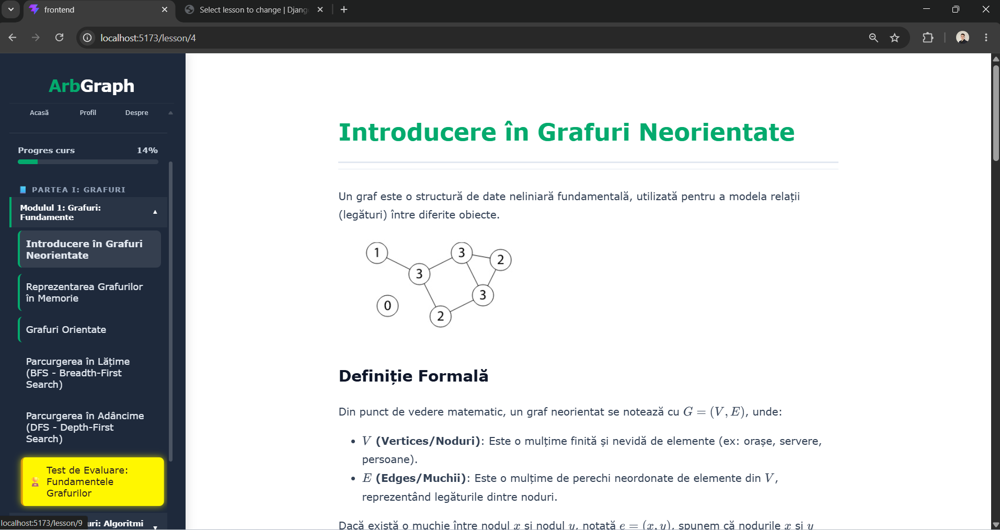
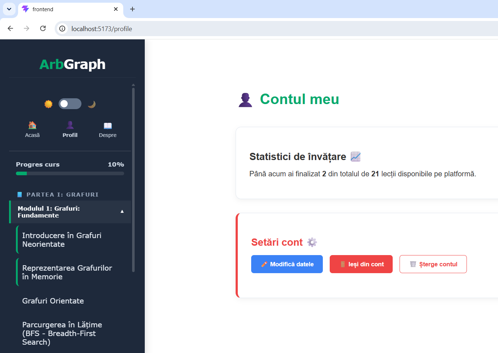
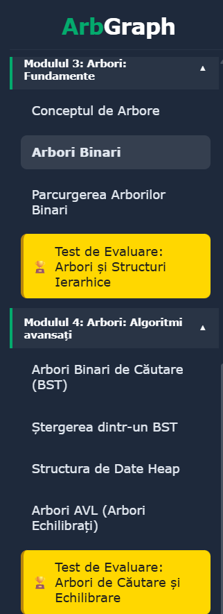

# ArbGraph

**An interactive web platform for learning tree and graph algorithms.**

ArbGraph helps students understand tree and graph algorithms through step-by-step visualisations, short lessons and practice exercises. It was built as my bachelor's thesis project in Computer Science at Titu Maiorescu University, Bucharest, and was graded 10/10 at the defence.

<p align="center">
  
</p>

<table>
  <tr>
    <td align="center"></td>
    <td align="center"></td>
  </tr>
  <tr>
    <td align="center"><sub>User profile and progress</sub></td>
    <td align="center"><sub>Course modules and evaluation tests</sub></td>
  </tr>
</table>
---

## Features

- **Step-by-step visualisations**: algorithms are animated on graphs and trees using custom SVG rendering, so you can follow every step.
- **Lessons with three tabs**: *Theory*, *Visualisation* and *Code* for each algorithm.
- **Exercises**: multiple-choice questions with immediate feedback.
- **Progress tracking**: each user's completed lessons and exercise results are saved.
- **Authentication**: user registration and login with token-based authentication.
- **REST API**: a clean separation between the React front end and the Django back end.

### What's inside
21 lessons and 37 exercises, organised in two learning paths:

**Graphs:** undirected and directed graphs, graph representation (adjacency matrix and list), BFS, DFS, Dijkstra, Roy-Warshall / Floyd-Warshall, minimum spanning trees with Prim and Kruskal, topological sorting.

**Trees:** trees and binary trees, binary tree traversals (preorder, inorder, postorder), binary search trees (search, insertion, deletion), heaps, AVL trees.

Each path includes evaluation tests.

---

## Tech stack

| Layer | Technologies |
|---|---|
| Front end | React, Vite, React Router, react-markdown, KaTeX (math rendering), SVG |
| Back end | Python, Django, Django REST Framework |
| Database | SQLite |
| Auth | Token authentication (Django REST Framework) |

### Data model
- `Lesson`: title, theory content (Markdown), category (graphs / trees) and order
- `Exercise`: multiple-choice question (4 options) linked to a lesson
- `UserProgress`: lessons completed by each user

---

## Project structure

```
ArbGraph/
├── backend/
│   ├── server/          # Django project settings and root URLs
│   ├── core/            # Main app: models, serializers, views, API routes
│   ├── fixtures/        # Lessons and exercises (initial data)
│   ├── media/           # Images and animations used in lessons
│   └── requirements.txt
└── frontend/
    └── src/
        ├── App.jsx
        └── components/  # Home, Auth, Sidebar, LessonView, Exercise, Profile, About
```

---

## Getting started

### Prerequisites
- Python 3.12+
- Node.js 20.19+

### 1. Back end (Django)

```bash
cd backend
python -m venv venv
# Windows: venv\Scripts\activate   |   macOS/Linux: source venv/bin/activate
pip install -r requirements.txt
```

Create a `.env` file in `backend/` (you can copy `.env.example`):

```
SECRET_KEY=change-me-to-a-long-random-string
DEBUG=True
```

Then create the database, load the lessons and start the server:

```bash
python manage.py migrate
python manage.py loaddata fixtures/initial_data.json
python manage.py runserver
```

The API runs at `http://localhost:8000/api/`.

### 2. Front end (React)

```bash
cd frontend
npm install
npm run dev
```

The app runs at `http://localhost:5173/`.

---

## API overview

| Method | Endpoint | Description |
|---|---|---|
| POST | `/api/register/` | Create an account |
| POST | `/api/login/` | Log in and receive an auth token |
| GET | `/api/lessons/` | List all lessons with their exercises |
| GET | `/api/lessons/<id>/` | Lesson details |
| GET / POST | `/api/completed-lessons/` | Get or save the user's completed lessons |
| GET / POST | `/api/progress/` | User progress |
| PATCH | `/api/update-profile/` | Change username or password |
| DELETE | `/api/delete-account/` | Delete the account |

Endpoints for progress and profile require the header `Authorization: Token <token>`.

---

## Author

**Alexandru Donici**
[LinkedIn](https://www.linkedin.com/in/alexandru-donici-b5593819b/) · [GitHub](https://github.com/alexdonici)

Bachelor's thesis, Titu Maiorescu University, Bucharest (2026)
Coordinator: Conf. dr. Daniela Joița
